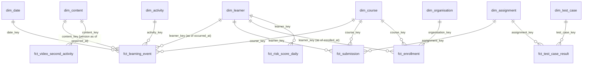

# Data warehouse design

The warehouse is the **gold layer of the Delta lakehouse**, modelled as a Kimball star schema,
plus one mart per business requirement. There is no second analytical database: Spark writes
the Delta tables, the Hive Metastore catalogs them, Trino serves them to SQL clients, Redis
serves the millisecond lookups. Everything is code in [`/warehouse`](../../warehouse).

| Role in the requirements | Decided stack (ADRs 0003-0006) | Implementation |
|---|---|---|
| Lakehouse storage (ACID, time travel) | Delta Lake on object storage | Delta 3.3 on S3 (MinIO built from source locally) |
| Catalog ("Databricks" metastore) | - | Hive Metastore 3.1.3 on Postgres (ADR 0010) |
| SQL warehouse for BI / dashboards | - | Trino, catalog `lakehouse`, read-only (ADR 0010) |
| Batch processing | Apache Spark | Spark 3.5 SQL models, `edu warehouse run` |
| Streaming into the lakehouse | Flink / Spark | Spark Structured Streaming landing (ADR 0011) |
| Low-latency serving | Redis | unchanged (online features, risk, notification state) |

## 1. Layers

```
Kafka / Debezium ─► BRONZE ─► SILVER ─► GOLD (dims + facts) ─► MART / FEATURES ─► Trino, Redis
                    raw, PII   clean,     conformed, keyed       per-BR, k-anon      dashboards,
                    append     pseudonym  star schema            policy-driven       API, ML
```

| Schema | Tables | Written by | Contract |
|---|---|---|---|
| `bronze` | 4 | landing stream | One row per Kafka record, exactly as received. Append-only, raw PII, restricted to `pii_steward`, retention 30 d (telemetry) / 90 d (CDC, events) via `edu.retention_days`. Replaying bronze rebuilds everything downstream. |
| `silver` | 19 | silver stream + batch reconcile | Typed, validated, deduplicated, schema-current, **pseudonymised** (HMAC, ADR 0007), direct identifiers dropped. CDC applied in LSN order (soft deletes). Change Data Feed on. |
| `gold` | 9 dims + 11 facts | `edu warehouse run --layer gold` | Kimball star schema (ADR 0012). Conformed dimensions with deterministic surrogate keys, facts with a declared grain. |
| `mart` | 4 | `--layer mart` | One table per BR, shaped for its consumer, thresholds from domain policies. `mart.org_progress` is the only table B2B admins can read. |
| `features` | 1 | `--layer features` | Offline feature store (BR2), one partition per `as_of_date` for point-in-time training; latest partition materialised to Redis. |
| `ops` | 2 | runner | `pipeline_runs` (every model build: window, rows, Delta version) and `dq_results`. |

## 2. Dimensional model

### Bus matrix

Which conformed dimensions each fact uses (D = date role, ● = key, ○ = durable natural key only).

| Fact (grain) | date | learner | course | content | activity | lesson | assignment | test case | org | BR |
|---|---|---|---|---|---|---|---|---|---|---|
| `fct_learning_event` (one event) | D | ● | ● | ● | ● | | | | | 6, 7, 8 |
| `fct_learner_daily_activity` (learner × course × day) | D | ● | ● | | | | | | | 2, 8 |
| `fct_video_second_activity` (video version × second × day) | D | | | ● | | | | | | 7 |
| `fct_submission` (one attempt) | D | ● | ● | | | | ● | | | 3, 4 |
| `fct_test_case_result` (attempt × test case) | D | ● | | | | | ● | ● | | 4 |
| `fct_lesson_progress` (learner × lesson) | | ● | ● | | | ● | | | | 6 |
| `fct_enrollment` (one enrollment, accumulating) | D×5 | ● | ● | | | | | | ● | 5, 6 |
| `fct_risk_score_daily` (learner × course × day) | D | ● | ● | | | | | | | 5 |
| `fct_dropout_alert` (one alert + outcome) | D | ● | ● | | | | | | | 5 |
| `fct_notification` (one outcome) | D | ● | | | | | | | | 1 |
| `fct_content_sync` (one content version) | | | ● | ● | | | | | | 8 |

### Core star (learning activity and assessment)



### Dimensions

| Dimension | Natural key | SCD | Notes |
|---|---|---|---|
| `dim_date` | date | static | 2020-2035, ISO weeks (Monday) for BR8 windows |
| `dim_activity` | verb | static | Verb vocabulary + `engagement_category` (EngagementPolicy) + `video_interaction` (BR7). A unit test fails if it drifts from the domain. |
| `dim_learner` | learner_pseudonym | **2** | Tracks organisation, advisor, country. B2B activity is attributed to the org at the time. |
| `dim_content` | content_id + version | **2** | One row per published version; a re-cut video gets new seconds (BR7 heatmaps are per version). |
| `dim_course` | course_id | 1 | `skill` (BR6 / BR2 mastery), `lesson_count` (completion denominator) |
| `dim_lesson`, `dim_assignment`, `dim_test_case`, `dim_organisation` | ids | 1 | test cases are unique only within an assignment |

Key rules (ADR 0012):
- **Deterministic surrogate keys**: `xxhash64(natural key)` (SCD1), `xxhash64(natural key, valid_from)`
  (SCD2). Rebuilding a dimension reproduces its keys, so dims and facts are built independently.
- **Inferred members** for late-arriving dimensions: telemetry about a learner whose CDC row has
  not landed yet creates `is_inferred = true` with the key the real row will get (first version
  starts 1900-01-01). When the row lands it overwrites the inferred member in place.
  Verified: learner `l-131` (events 2 days before its CDC row) kept key `-6972257774409928177`
  through the transition, and no fact was re-keyed.
- **Unknown member** `-1` for "not applicable" (e.g. the content of a `logged_in` event).
- SCD2 versions open at the OLTP `updated_at`; changes are captured at silver cadence.

### Facts: measures, additivity, load

| Fact | Key measures | Additivity | Strategy | Partition / Z-order |
|---|---|---|---|---|
| `fct_learning_event` | video_position, is_late, lateness_sec | n/a (event) | window | event_date / course_key, learner_key |
| `fct_learner_daily_activity` | events, sessions, logins, views, attempts, discussions, completions, engagement_score | additive | window | activity_date / course_id, learner_pseudonym |
| `fct_video_second_activity` | play / pause / seek counts, unique_learners | counts additive; uniques **per day only** | window | activity_date / content_key, second |
| `fct_submission` | score, pass_rate, tests, runtime, memory, seconds_to_grade | semi (rates) | window (7 d) | submitted_date / assignment_id |
| `fct_test_case_result` | is_passed, duration_ms | additive (count_if) | window (7 d) | submitted_date / assignment_id, test_case_id |
| `fct_lesson_progress` | percent_done, is_completed | snapshot | full | - |
| `fct_enrollment` | lessons_completed, progress_ratio, avg_pass_rate, days_to_complete | snapshot | full | - |
| `fct_risk_score_daily` | max / last risk score, alerts_fired | non-additive | window | score_date |
| `fct_dropout_alert` | risk_score, `dropped_within_30d`, `active_after_alert` (outcome labels) | n/a | full | - |
| `fct_notification`, `fct_content_sync` | outcome, channel / seconds_to_index | counts | window / full | event_date / - |

Conformed business rules worth knowing:
- **Lesson completion** = CDC `percent_done = 100` **or** a telemetry `completed` event on the
  lesson's content, whichever came first (`fct_lesson_progress`).
- **Video seconds** beyond a version's duration are clamped to its last second (as `BuildVideoHeatmap`).
- **Grading**: the latest sandbox run of a submission supersedes earlier runs.

## 3. Marts (one per business requirement)

Each mart re-implements an analytics use case set-based in SQL. Thresholds are injected from the
domain value objects (`entrypoints/batch/warehouse_job.py::policy_params`), recorded on every row,
and unit-tested against the domain; `EngagementPolicy.is_declining` was cross-checked on mart output.

| Mart | BR / reader | Semantics | Policy |
|---|---|---|---|
| `mart.assessment_item_stats` | BR4 instructors | pass rate per (assignment, test case) over 28 days; anomalous when attempts >= 30, pass rate <= 0.35 and >= 0.30 below the assignment median | `AnomalyThreshold` |
| `mart.org_progress` | BR6 B2B admins | per org × course: cohort size, completion rate, mean mastery; **cells with < k learners publish only their size** | `MinCohortPolicy(k=5)` |
| `mart.video_heatmap` | BR7 instructors | dense per-second grid per video version over 28 days, exact distinct learners, intensity 0-1 | - |
| `mart.engagement_trend` | BR8 instructors | 4 weekly windows per learner × course, declining = -30 % in each of the last two windows | `EngagementWeights`, decline ratio 0.30 |
| `features.learner_longterm` | BR2 recommender | `ComputeBatchFeatures` over 30 days, per `as_of_date` | feature registry v1 |

BR1, BR3 and BR5 are served in real time: notification service, grading service, and the
BR4/BR5 persistent runtime of ADR 0009 (Debezium -> Spark Structured Streaming -> PostgreSQL
`analytics` marts, risk states and alerts behind the instructor/advisor dashboards). The
warehouse is the analytical history next to that serving path: `mart.assessment_item_stats`
for trend/BI over BR4, `fct_risk_score_daily` / `fct_dropout_alert` with alert-precision labels
for BR5, `fct_notification`, `fct_submission`.

## 4. Physical design

- **Delta features**: ACID MERGE / `INSERT ... REPLACE WHERE` / dynamic partition overwrite,
  Change Data Feed on silver, time travel (`FOR VERSION AS OF`, 7-day vacuum horizon).
- **Partitioning**: only by a date column that queries filter on (event/activity/submitted/score
  date, `as_of_date`); small tables are unpartitioned. Bronze by `ingest_date` (+ table / topic).
- **Clustering**: `edu.zorder` table property, applied by `OPTIMIZE ... ZORDER BY` in the daily
  maintenance job; streaming writers' small files are compacted by the same job.
- **Policies as table properties**: `edu.pii`, `edu.owner`, `edu.retention_days`, `edu.zorder`
  are visible to every engine (`SHOW TBLPROPERTIES`, Trino `$properties`).
- Schema evolution is explicit (`autoMerge` off): change the DDL, add a migration statement.

## 5. Data quality gates

Evaluated after each layer (`warehouse/quality`, logged to `ops.dq_results`); `error` stops the run.

| Gate | Severity | Guards |
|---|---|---|
| `silver_event_id_unique` | error | dedup of mobile re-sends |
| `silver_no_raw_identifiers` | error | PII boundary: only `k<ver>_<24 hex>` pseudonyms past bronze |
| `bronze_dlq_rate` | warn | > 5 % of telemetry rejected |
| `gold_dim_learner_scd2` | error | one current version, no overlapping validity |
| `gold_orphan_keys` | error | every fact key exists in its dimension |
| `gold_unresolved_learners` | warn | facts resolved to the unknown member |
| `mart_org_progress_k_anonymity` | error | no rate published for a cohort < k |
| `mart_rates_in_range` | error | ratios within [0, 1] |

## 6. Security and privacy

- Raw identifiers exist only in bronze; silver/gold/mart carry HMAC pseudonyms
  (`pseudonymize()` SQL function = the telemetry context's `HmacPseudonymizer`, same key, so
  telemetry, CDC and events join). Email / full name / IP / device id are dropped.
- Trino roles (`infra/trino/rules.json`), all read-only:

| User | bronze | silver | gold | mart | features / ops |
|---|---|---|---|---|---|
| `pii_steward` | ✔ | ✔ | ✔ | ✔ | ✔ |
| `analyst` | ✘ | ✔ | ✔ | ✔ | ✔ |
| `app` (API, dashboards) | ✘ | ✘ | ✔ | ✔ | ✘ |
| `b2b_admin` | ✘ | ✘ | ✘ | `org_progress` only | ✘ |

## 7. Querying

```bash
docker exec -it de261-trino trino --user analyst --catalog lakehouse
```
```sql
-- BR4: suspicious test cases
SELECT assignment_id, test_case_id, attempts, pass_rate, assignment_median_pass_rate
FROM mart.assessment_item_stats WHERE as_of_date = DATE '2026-10-17' AND is_anomalous;

-- BR7: hottest seconds of each version of a video
SELECT content_version, second, seek_count, unique_learners
FROM mart.video_heatmap WHERE content_id = 'v-sql-joins' ORDER BY intensity DESC LIMIT 10;

-- Time travel / audit
SELECT count(*) FROM gold.fct_learning_event FOR VERSION AS OF 1;
SELECT model, window_start, window_end, rows_written, table_version FROM ops.pipeline_runs;
```

## 8. Verified behaviour (local stack, 35 days of synthetic data)

`edu warehouse seed-bronze` writes landing-format data with one scenario per requirement; the
full build (43 models) passes all gates. Highlights:

- BR4 flags only the broken test (`a-py-even/t5_pairs`, 0/68 passes); the hard-but-valid
  `t3_ties` (0.55) is not flagged.
- BR5: l-004's daily risk climbs past 0.70 on 2026-10-08, one alert fires, the learner drops
  six days later, so the alert's outcome label is `dropped_within_30d = true`.
- BR6: Globex cohorts of 2 are published with size only; Acme's are reported.
- BR7: separate heatmaps for v1 (420 s) and the re-cut v2 (390 s) of `v-sql-joins`.
- BR8: l-004 flagged as declining in both courses.
- Incremental runs (backfill, then two increments, then a rerun) are idempotent: table
  fingerprints are identical after the rerun. A late mobile sync pulled the gold window back
  two days automatically.

## 9. Limitations and next steps

- BR5 history: `silver.risk_scores` / `dropout_alerts` read `risk.learner_score.v1` /
  `risk.dropout_alert.v1`. The ADR 0009 runtime keeps its scores and alerts in PostgreSQL
  `analytics`; publish them to those topics (or add `analytics` alert tables to the CDC
  connector) to feed the warehouse from the live path. The synthetic generator covers it today.
- Redis materialisation of `features.learner_longterm` (`batch_features_job`) and the corpus
  chunking/embedding job remain TODO, as does OpenSearch in the compose stack.
- For sub-second dashboards at scale, attach StarRocks to the same metastore (ADR 0010).
- Accumulating snapshots (`fct_enrollment`, `fct_lesson_progress`) rebuild fully; switch to
  CDF-driven MERGE once volumes warrant it.
