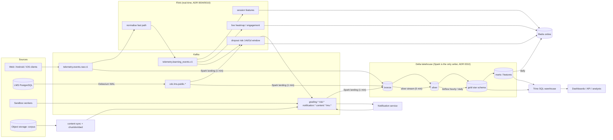

# Pipeline design

How data moves from the four raw sources to the serving layers, per business requirement.
Engines and stores are the ones decided in ADRs 0003-0006; ADRs 0009-0012 record the decisions
added while designing the pipelines and the warehouse ([data-warehouse.md](data-warehouse.md)).

## 1. End-to-end flow



## 2. Pipeline catalogue

| # | Pipeline | BR | Engine / trigger | Source → sink | Freshness SLA | Idempotency |
|---|---|---|---|---|---|---|
| P1 | CDC capture | 5, 6 | Debezium (pgoutput, replication slot) | LMS WAL → `cdc.lms.public.<table>` | seconds | Kafka key = PK, per-row LSN |
| P2 | Telemetry normalisation (fast path) | 6 | Flink, continuous | `telemetry.events.raw.v1` → `telemetry.learning_events.v1` + DLQ | < 5 s | event_id; same use case as P4 |
| P3 | Lakehouse landing | all | Spark Structured Streaming, 1 min | all topics → `bronze.*` (append) | ≈ 1 min | checkpoint + Delta transactional sink (exactly-once) |
| P4 | Bronze → silver | all | Spark Structured Streaming, 5 min (+ hourly batch reconcile) | `bronze.*` → `silver.*` | ≈ 6 min | MERGE on business keys; CDC applies only newer LSNs |
| P5 | Gold dimensional model | 4-8 | Spark batch, Airflow `medallion_daily` (hourly) | `silver.*` → `gold.dim_*`, `gold.fct_*` | ≤ 1 h | full rebuild / SCD2 MERGE / `REPLACE WHERE` window |
| P6 | BR marts | 4, 6, 7 | Spark batch, `analytics_marts_daily` 02:00 | gold → `mart.*` | daily (closed day) | replace `as_of_date` partition |
| P7 | Engagement trend | 8 | Spark batch, `engagement_weekly` Mon 02:00 (+ Flink live score) | gold → `mart.engagement_trend` | weekly / live in Redis | replace `as_of_date` partition |
| P8 | Batch features | 2 | Spark batch, `features_daily` (on gold refresh) | gold → `features.learner_longterm` → Redis | 24 h (registry SLA) | replace `as_of_date` partition |
| P9 | Session features | 2 | Flink, session windows (30 min gap) | `telemetry.learning_events.v1` → Redis + `features.session.v1` | 30 s | keyed state, Redis TTL |
| P10 | Dropout risk | 5 | Flink, sliding window 14 d / 1 d | CDC + learning events → `risk.dropout_alert.v1`, `risk.learner_score.v1`, Redis | seconds | cooldown per learner-course |
| P11 | Notification | 1 | Kafka consumer service | `lms.*`, `risk.*`, `grading.*` → push / in-app / email + `notification.*` | seconds | Redis dedup key + rate limit |
| P12 | Grading ingestion | 3 | Kafka consumer service | `grading.submission_received.v1` → sandbox → `grading.sandbox_result.raw.v1`, `grading.submission_graded.v1` | seconds | (submission, worker_run) |
| P13 | Content sync / embedding | 8 | service + Spark every 6 h | corpus versions → cache invalidation, OpenSearch, `content.*`, `silver.content_chunks` | minutes | (content_id, version) |
| P14 | Lakehouse maintenance | ops | Spark batch, `lakehouse_maintenance` 04:00 | retention, OPTIMIZE / Z-order, VACUUM | daily | idempotent |

P3–P8 and P14 are implemented in this repo (`edu stream lakehouse-landing`, `edu warehouse run`,
`edu batch lakehouse-maintenance`, `orchestration/airflow/dags`). P2 and P9–P13 run the
existing domain use cases; their production adapters are still the TODO stubs listed in the README.

## 3. Hand-offs between engines

- **Flink never writes Delta** (ADR 0010). Its outputs are Kafka topics and Redis keys. Topics
  the lakehouse needs (`risk.learner_score.v1`, `risk.dropout_alert.v1`, `telemetry.events.dlq.v1`)
  are landed like any other source.
- **One normalisation, two engines.** Flink normalises for the real-time branch; Spark runs the
  same `NormalizeEvents.normalize_one` over bronze for the lakehouse
  (`contexts/telemetry/infrastructure/spark_normalizer.py`). Same code, same pseudonyms, same
  DLQ decisions.
- **One silver SQL, two cadences.** The silver models in `warehouse/models.yaml` read a view
  `_src`: in streaming it is the micro-batch (foreachBatch), in batch it is the bronze
  `ingest_date` window. Both paths MERGE into the same tables idempotently.

## 4. Incremental processing, late and out-of-order data

| Problem | Where | Mechanism |
|---|---|---|
| Kafka redelivery, job retry | bronze | Structured Streaming checkpoints + Delta sink (exactly-once) |
| Client re-sends (offline mobile) | silver | MERGE on `event_id` (insert-only); gate `silver_event_id_unique` |
| CDC out of order / replayed | silver | latest change per key by `lsn`; MERGE only when `lsn` is newer; replays write nothing (no Delta commit) |
| Deletes in the OLTP | silver | Debezium `rewrite` mode → `is_deleted = true` (soft delete) |
| Late events (mobile synced days later) | gold | window models declare a `late_data` driver; the window reaches back to the oldest event date silver received since the model's last build (verified: a run of 10-06..14 extended to 10-04) |
| Facts before dimensions | gold | inferred members with the final key (ADR 0012) |
| Retention deletes on bronze | silver stream | `skipChangeCommits` so purges never stop the stream |
| Schema evolution of client payloads | silver | `SchemaMigrator` chain (1.0 → 1.1), validated by contract; unknown → DLQ |

Every batch command is idempotent for a given `--run-date`, so Airflow retries and
`airflow dags backfill` are safe; `--start-date` rebuilds any range.

## 5. Orchestration

| DAG | Schedule | Tasks | Dataset |
|---|---|---|---|
| `medallion_daily` | hourly | `silver_reconcile` → `gold` | produces `lakehouse://silver`, `lakehouse://gold` |
| `analytics_marts_daily` | 02:00 daily (`ds` = closed day) | `gold_refresh` → BR4 / BR6 / BR7 marts | produces `lakehouse://mart` |
| `engagement_weekly` | Mon 02:00 | `engagement_trend` | produces `lakehouse://mart` |
| `features_daily` | on `lakehouse://gold` | `learner_longterm` (+ Redis, TODO) | consumes gold |
| `lakehouse_maintenance` | 04:00 daily | retention, OPTIMIZE / Z-order, VACUUM | - |

Streaming jobs (Flink jobs, `lakehouse-landing`) and services are long-running deployments, not
DAG tasks. Every model build is logged to `ops.pipeline_runs`, every gate to `ops.dq_results`.

## 6. Failure handling and replay

| Situation | Action |
|---|---|
| Bad transform deployed | fix SQL, `edu warehouse run --run-date D --start-date D0 --layer silver` (bronze is the replay log), then gold / marts |
| Quality gate fails | the layer stops; inspect `ops.dq_results`, fix, rerun the same command |
| Telemetry rejected | rows in `bronze.telemetry_dlq` keep payload + reason; fix the validator / migrator, rerun silver for the window |
| Stream lost its checkpoint | delete the checkpoint and restart: bronze append from `earliest` duplicates nothing downstream (silver MERGE), or rebuild bronze from Kafka retention |
| Replication slot lag | monitor WAL growth (ADR 0003); Debezium resumes from the slot |
| Need old state | Delta time travel (`FOR VERSION AS OF`, versions in `ops.pipeline_runs`) within the 7-day vacuum horizon |

## 7. Run it locally

```bash
docker compose up -d                                  # incl. seaweedfs, hive-metastore, trino
docker compose run --rm spark-jobs edu infra create-topics infra/kafka/topics.yaml
docker compose run --rm spark-jobs edu warehouse bootstrap        # schemas + 50 tables
# either real CDC + streaming ...
curl -X POST -H "Content-Type: application/json" --data @infra/debezium/postgres-connector.json http://localhost:8083/connectors
docker compose --profile pipelines up -d lakehouse-streaming
# ... or synthetic history for a demo
docker compose run --rm spark-jobs edu warehouse seed-bronze --end-date 2026-10-17 --days 35
docker compose run --rm spark-jobs edu warehouse run --run-date 2026-10-17 --start-date 2026-08-01
docker exec -it de261-trino trino --user analyst --catalog lakehouse
```
